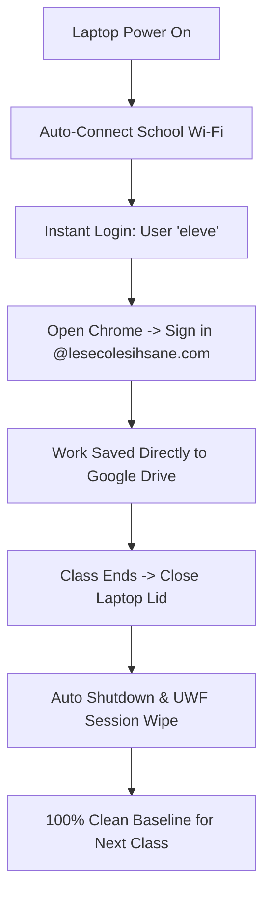

# 🛡️ Active Directory Infrastructure & Security Project: Salle SI 110
### Les Écoles Ihsane — Computer Lab Automated Management System


---

## 📌 Executive Summary

This repository contains the complete **Active Directory Infrastructure, Group Policy Objects (GPO), PowerShell Automation Scripts, and Zero-Persistence Security Architecture** for **Salle d'Informatique SI 110** at **Les Écoles Ihsane**.

The lab consists of **27 laptops** used by **11 different classes (~300+ students)** throughout the week. 

### 🎯 Key Design Objectives:
1. **Zero Admin Maintenance**: Single shared lab user account (`eleve` without password) for instant 5-second logins, eliminating password resets completely.
2. **Student Authentication & Cloud Sync**: Students access their Google Workspace accounts (`@lesecolesihsane.com`) via Google Chrome / Google Drive.
3. **Strict System Lockdown**: GPO policies block Control Panel, system settings, registry editing, and unapproved `.exe` installations.
4. **Remote Software Deployment**: Silent installation of `.msi` and `.exe` software packages across all 27 laptops simultaneously from the Domain Controller.
5. **Zero-Persistence Session Wipe (Deep Freeze)**: Native Windows **Unified Write Filter (UWF)** and GPO lid-close action auto-wipe 100% of session files, temp downloads, and browser history on reboot/shutdown.
6. **Automated Wi-Fi Deployment**: Automatic Wi-Fi connection at boot time via GPO / `netsh` script without revealing Wi-Fi passwords to students.

---

## 📐 Architecture & Lifecycle Overview



---

## 📁 Repository Structure

```
AD_IHSANE/
├── README.md                          # Primary Project Documentation
├── scripts/
│   ├── 01_Create_OU_and_SharedUser.ps1  # Creates OU=SI110 & User 'eleve'
│   ├── 02_Set_DomainPasswordPolicy.ps1 # Disables password complexity & enables blank passwords
│   ├── 03_Deploy_RemoteSoftware.ps1    # WinRM push installer script for all 27 laptops
│   ├── 04_Export_Import_WiFi.ps1       # Netsh export/import WiFi profile automation
│   ├── 05_Enable_UWF_DeepFreeze.ps1    # Powershell script to enable UWF (Deep Freeze) on laptops
│   └── Join_Domain_Client.ps1         # Client-side domain join & auto-rename script
├── gpo_configs/
│   ├── GPO_SI110_Security_Settings.md  # Step-by-step GPO configuration guide
│   └── WiFi_Profile_Template.xml       # Template XML for netsh WiFi import
└── docs/
    ├── Architecture_Diagram.md        # Technical flow & multi-class design
    └── Sysadmin_Maintenance_Guide.md  # Daily operational guide for IT admins
```

---

## 🛠️ Step-by-Step Implementation Guide

### 1. Active Directory Setup (Domain Controller)
Run the administrative setup scripts on your Domain Controller (`LEI.IDEMY`):

```powershell
# 1. Disable Password Complexity to allow blank/simple passwords
.\scripts\02_Set_DomainPasswordPolicy.ps1

# 2. Create OU=SI110 and user 'eleve' without password
.\scripts\01_Create_OU_and_SharedUser.ps1
```

### 2. Client Laptop Deployment (27 Laptops)
On each laptop, execute the domain join and UWF activation scripts:

```powershell
# 1. Join domain LEI.IDEMY and rename to SI110-PC01 ... SI110-PC27
.\scripts\Join_Domain_Client.ps1 -PCName "SI110-PC01"

# 2. Enable Unified Write Filter (UWF) for session wipe on reboot
.\scripts\05_Enable_UWF_DeepFreeze.ps1
```

### 3. Remote Software Installation
To push software silently to all 27 laptops from the server:

```powershell
.\scripts\03_Deploy_RemoteSoftware.ps1 -InstallerPath "\\LEI-DC\SoftwareShare\ChromeSetup.msi"
```

---

## 🔒 Security Baseline & Policies

| Policy Scope | Setting | Target |
|---|---|---|
| **Control Panel** | Prohibit access to Control Panel and PC settings | `Enabled` |
| **Power Management** | Lid Switch Action (Plugged In / Battery) | `Shut Down` |
| **Software Install** | Standard User Installation Rights | `Blocked (UAC Required)` |
| **Wi-Fi Credentials** | Automatic Connection via GPO / netsh | `Hidden from Students` |
| **Session Wipe** | UWF Volume Protection | `C: Drive Write-Protected` |

---

## 👥 Authors & Credits

* **System Administrator**: IT Department — Les Écoles Ihsane
* **Domain**: `LEI.IDEMY`
* **Target Scope**: Salle d'Informatique SI 110 (27 Laptops, 11 Classes, 300+ Students)
